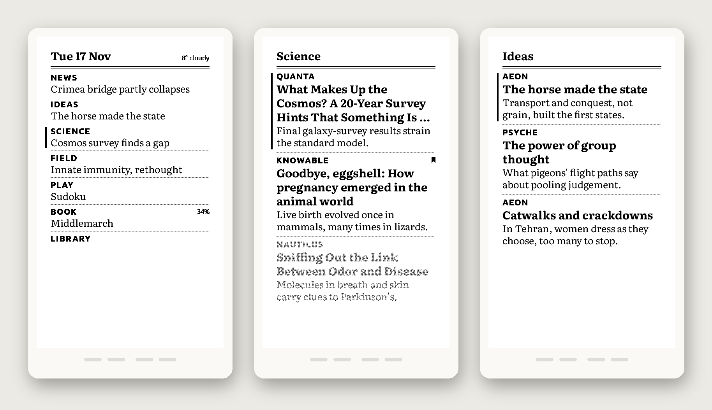
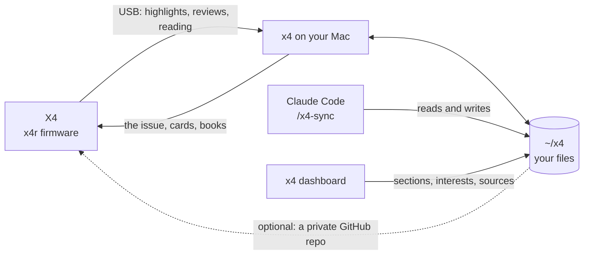

# x4r

<picture>
  <source media="(prefers-color-scheme: dark)" srcset="docs/public/screens-dark.png">
  
</picture>

x4r turns the Xteink X4 into a newspaper and a book. Once a day Claude edits one issue for you:
up to three articles in each of your sections, chosen from the web and the feeds you follow, written
by other people, whole. Tomorrow's issue replaces it. You read, highlight a sentence, and the
highlight comes back as a question at the end of a later chapter.

The phone's feed never ends. This paper does: the finish line is the edge of the issue.

## What's on the device

**The paper.** One front page with a line per section, eight sections at most, each a short
headline for its first unread article. Left and Right leaf through the sections. A piece you hold
Confirm on is kept in the Library after its issue is gone. A piece can carry a guess before you read
it ("does it raise or lower…?") and, after it, a link to something you read weeks ago, or a
forecast you settle later.

**The book.** Highlights grow by the sentence, a hold makes them grow by the paragraph. Claude turns
them into cards: a cloze, a choice between near misses, or an explain-back. One due card comes after
each chapter, scheduled by FSRS on the device, offline for weeks. A book you return to after a few
days opens on a short recap of where you were.

**Play.** Sudoku, nonograms and logic grids generated on the device; chess tactics from the Lichess
database; mental arithmetic; a daily five-letter word and a 7x7 crossword of rare words. Every game is built for buttons and e-ink: no timers, no animation.

**The agenda.** On Wi-Fi the X4 sets its clock, reads your calendars and the forecast, then turns
the radio off. The sleep screen shows the day ahead and the card you are most likely to forget.

## How it works



The `x4` tool fetches, converts, checks and uploads. It never calls a language model. Claude Code
does the choosing and writing when you run `/x4-sync`. Everything Claude knows about you is a plain
file in `~/x4` that you can read and edit.

## You need

- An Xteink X4 and a USB-C data cable
- A Mac (Linux probably works but is untested) with [uv](https://docs.astral.sh/uv/)
- [Claude Code](https://claude.com/claude-code)

## Set up

**1. Get the code and the tool.**

```bash
git clone https://github.com/VeghV03/x4r.git && cd x4r
```

```bash
uv tool install --editable ./companion
```

**2. Back up the stock firmware.** Plug in the X4 and wake it. This reads all 16 MB of flash and
checks the copy. Keep the file; it is the only way back.

```bash
x4 backup --out backups
```

**3. Flash x4r.** Download `x4r-<version>.factory.bin` from
[Releases](https://github.com/VeghV03/x4r/releases) and write it from the start of flash:

```bash
uvx esptool --chip esp32c3 write-flash 0x0 x4r-0.1.0.factory.bin
```

Later versions install over USB with `x4 flash x4r-<version>.bin`. To build from source instead,
see [Build](#build).

**4. Make your home.** Copy the starter files, then shape the paper in the dashboard.

```bash
mkdir -p ~/x4 && cp -Rn companion/examples/home/. ~/x4/
```

```bash
x4 dashboard
```

<picture>
  <source media="(prefers-color-scheme: dark)" srcset="docs/public/dashboard-dark.png">
  
</picture>

**5. Fonts, dictionaries and games.**

```bash
x4 font install && x4 dict install en && x4 words install en && x4 chess install
```

**6. The first issue.** With the X4 plugged in, open Claude Code in this folder and run `/x4-sync`.

**7. Wi-Fi, if you want the agenda.**

```bash
x4 wifi add "<your network>"
```

```bash
x4 calendar add "<a calendar's secret iCal address>"
```

```bash
x4 weather "<your city>"
```

## Without the Mac

The issue can reach the X4 while the Mac is off. `~/x4` becomes a private GitHub repo, the X4
holds a token that opens only that repo, and a scheduled Claude run in the cloud writes the issue
each morning. [cloud/run.md](cloud/run.md) sets it up.

## Your paper

| File | What it is |
|---|---|
| `sections.md` | One line per section: its name, then what belongs in it |
| `interests.md` | What you want to understand, and tracks you want to get good at |
| `feeds.yaml` | Sources you follow |
| `fields.md` | One field a week, far from your usual reading, with a primer and a primary text |
| `settings.yaml` | The language Claude writes in |
| `football.yaml` | Clubs to follow, from [football-data.org](https://www.football-data.org) (free key) |
| `taste.md`, `seen.md` | Film picks: what you like, what you have watched |

`x4 dashboard` edits all of them. [companion/examples/a-hungarian-reader](companion/examples/a-hungarian-reader/sections.md)
is one reader's paper: Hungarian news, institutions, cognitive science, design, football and film.

## Build

```bash
python3 -m venv firmware/.venv && firmware/.venv/bin/pip install platformio
```

```bash
firmware/.venv/bin/pio run -d firmware -e x4r -t upload
```

The first install has to go through `-t upload` (or the factory image above) so the bootloader with
app rollback is on the device. The USB protocol is [docs/PROTOCOL.md](docs/PROTOCOL.md); the files on
the SD card and in `~/x4` are [docs/DATA.md](docs/DATA.md).

## Going back

```bash
uvx esptool --chip esp32c3 write-flash 0x0 backups/stock-<mac>.bin
```

## Credits

The firmware is a fork of [CrossPoint Reader](https://github.com/crosspoint-reader/crosspoint-reader),
on the [FreeInk SDK](firmware/freeink-sdk), both MIT. Chess puzzles from the
[Lichess database](https://database.lichess.org/#puzzles) (CC0). Dictionaries and word lists from
Wiktionary via [kaikki.org](https://kaikki.org) and [FrequencyWords](https://github.com/hermitdave/FrequencyWords).
Forecasts from [Open-Meteo](https://open-meteo.com). Fonts from [Google Fonts](https://fonts.google.com).

x4r is not affiliated with Xteink. MIT licence.
